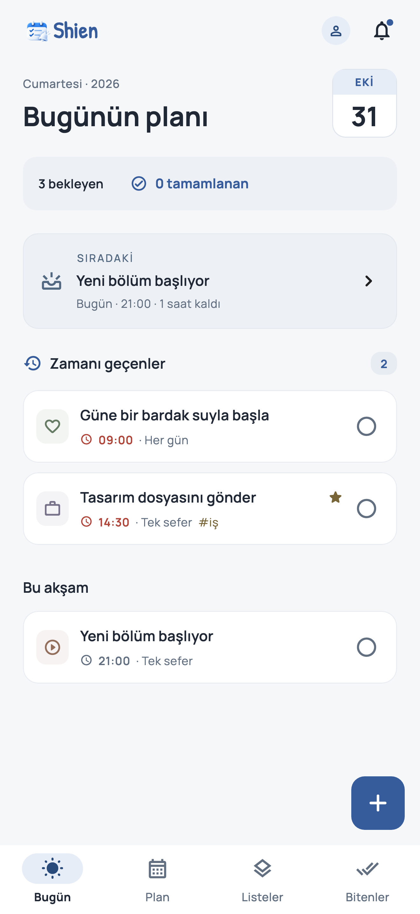
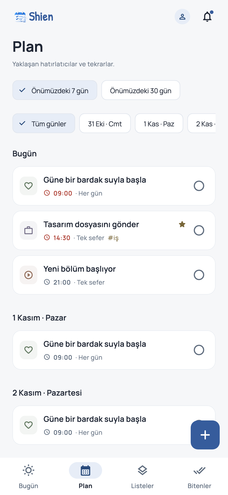
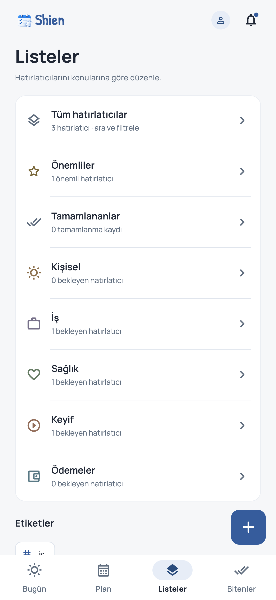

# Shien

Shien, günlük işlerini ve düzenli hatırlatmalarını tek yerde planlamanı sağlayan bir Android ve iOS uygulamasıdır. Günün programını görüntüleyebilir, yaklaşan hatırlatmalarını takip edebilir ve tamamladığın işleri geçmişte görebilirsin.

## Özellikler

- **Esnek planlama:** Tek seferlik veya tekrarlayan hatırlatmalar; birden fazla saat, ön uyarı ve erteleme seçenekleri.
- **Düzenli görünüm:** Bugün, Plan, Listeler ve Bitenler ekranları; kategori, etiket, önem ve arama filtreleri.
- **Hızlı ekleme:** Türkçe ve İngilizce tarih-saat ifadelerinden planlama önerileri.
- **Bildirimler ve widget:** Ses seçimi, bildirimden tamamlama veya erteleme ve ana ekran bileşenleri.
- **Hesaba bağlı senkronizasyon:** Google veya e-posta hesabıyla hatırlatmaların ve profil bilgilerinin bulutta saklanması.
- **Misafir kullanımı:** Hesap açmadan, hatırlatmaları cihazda saklayarak kullanım.
- **Yedekleme:** JSON biçiminde dışa aktarma ve mevcut kayıtların üzerine yazmadan içe aktarma.
- **Kişiselleştirme:** Türkçe ve İngilizce dil desteği; açık, koyu ve sistem teması.

## Ekran görüntüleri

Örnek kayıtlarla hazırlanmış uygulama ekranları:

  

## Veriler ve gizlilik

Misafir hatırlatmaları cihazda tutulur ve otomatik olarak buluta aktarılmaz. Google veya e-posta hesabıyla giriş yapıldığında hesaba özel bulut senkronizasyonu kullanılır. Misafir kayıtları isteğe bağlı olarak hesaba aktarılabilir. Uygulama reklam veya kullanım analitiği içermez.

Bildirimler cihaz üzerinde zamanlanır. Teslim zamanı ve ses; bildirim izinleri, pil tasarrufu, sessiz mod ve odak ayarlarından etkilenebilir. Misafir kayıtları ve henüz eşitlenmemiş değişiklikler uygulama kaldırıldığında kaybolabilir.

[Gizlilik politikası](docs/PRIVACY_POLICY.md) · [Hesap silme](docs/ACCOUNT_DELETION.md)

## Geliştirme

Uygulama Flutter ile geliştirilmiştir. Durum yönetiminde Cubit, yerel depolamada Hive, kimlik doğrulama ve bulut senkronizasyonunda Firebase kullanılır. Çeviriler `easy_localization` ile yönetilir.

```sh
flutter pub get
flutter run
```

Kod ve test kontrolleri:

```sh
flutter analyze --no-pub
flutter test --no-pub
```

Firebase bağlantısı ve platform gereksinimleri [kurulum belgesinde](docs/FIREBASE_SETUP.md), sürüm kontrol listesi [yayın planında](docs/RELEASE_PLAN.md) açıklanır. Mevcut sürüm geliştirme aşamasındadır.

## Destek

Sorular ve geri bildirimler için: [emrealidemirel@gmail.com](mailto:emrealidemirel@gmail.com)
