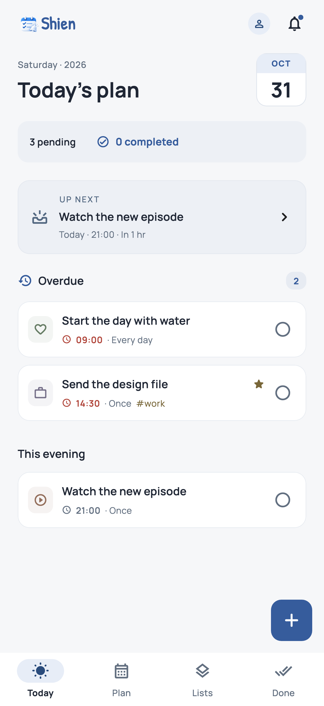
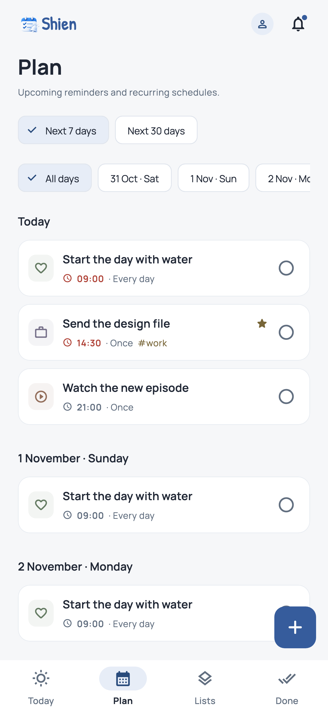
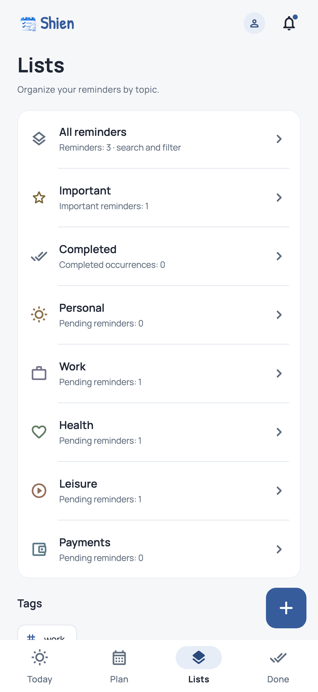

# Shien

**English** · [Türkçe](README.tr.md)

Shien is a reminder app for Android and iOS that brings daily tasks and recurring reminders together. View your schedule, keep track of upcoming reminders, and review completed tasks in one place.

## Features

- **Flexible scheduling:** One-time and recurring reminders with multiple times, advance alerts, and snooze options.
- **Organized views:** Today, Plan, Lists, and Completed screens, with categories, tags, priority, and search filters.
- **Quick entry:** Scheduling suggestions based on Turkish and English date and time expressions.
- **Notifications and widgets:** Sound selection, complete or snooze actions from notifications, and home screen widgets.
- **Account sync:** Cloud storage for reminders and profile information when signed in with Google or email.
- **Guest mode:** Use the app without an account and keep reminders on your device.
- **Backups:** Export to JSON and import without overwriting existing reminders.
- **Personalization:** Turkish and English support, with light, dark, and system themes.

## Screenshots

App screens with sample reminders:

  

## Data and privacy

Guest reminders stay on your device and are not automatically uploaded. Signing in with Google or email enables account-specific cloud sync. You can choose to import guest reminders into your account. The app contains no ads or usage analytics.

Notifications are scheduled on your device. Delivery time and sound can be affected by notification permissions, battery saving, silent mode, and focus settings. Uninstalling the app may remove guest reminders and changes that have not yet synced.

[Privacy policy](docs/PRIVACY_POLICY.md) · [Account deletion](docs/ACCOUNT_DELETION.md)

## Development

Shien is built with Flutter. It uses Cubit for state management, Hive for local storage, and Firebase for authentication and cloud sync. Translations are managed with `easy_localization`.

```sh
flutter pub get
flutter run
```

Run static analysis and tests:

```sh
flutter analyze --no-pub
flutter test --no-pub
```

See the [setup guide](docs/FIREBASE_SETUP.md) for Firebase configuration and platform requirements, and the [release checklist](docs/RELEASE_PLAN.md) for release preparation. The app is currently in development.

## Support

Developed by [Emre Ali Demirel](https://github.com/emrealidemirel).

Other projects: [Storify](https://github.com/emrealidemirel/storify) · [BugPilot AI](https://github.com/emrealidemirel/bugpilot-ai)

For questions and feedback: [emrealidemirel@gmail.com](mailto:emrealidemirel@gmail.com)
